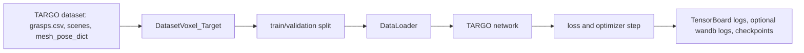
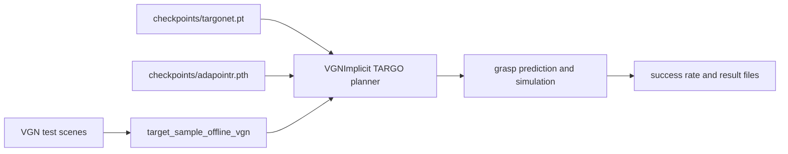

# TARGO: Benchmarking Target-driven Object Grasping under Occlusions

[Yan Xia](https://yan-xia.github.io)\*, [Ran Ding](https://randing2000.github.io)\*, [Ziyuan Qin](https://scholar.google.com/citations?user=pcCR2lUAAAAJ)\*, [Guanqi Zhan](https://www.robots.ox.ac.uk/~guanqi), [Kaichen Zhou](https://www.cs.ox.ac.uk/people/kaichen.zhou), [Long Yang](https://scholar.google.com/citations?user=KOTg0mQAAAAJ&hl), [Hao Dong](https://zsdonghao.github.io), [Daniel Cremers](https://cvg.cit.tum.de/members/cremers)

Accepted at IJCV 2026.

This repository contains the clean training and inference code for TARGO and TARGO-Net.

- `train_targo.py`: train the original TARGO model.
- `inference_targo.py`: run TARGO inference on the VGN evaluation set.

The import dependencies used by those scripts are kept under `src/`, `setup/`, and `serialization/`.

## Overview

TARGO is a benchmark for TARget-driven Grasping under Occlusions. It evaluates how occlusion affects 6D grasp prediction in cluttered scenes and provides synthetic and real-world evaluation data, a scalable training dataset, and TARGO-Net, a transformer-based grasping model with shape completion for robust target-driven grasping.

## Environment Setup

Create a Python environment and install the runtime dependencies. Python 3.10 is the tested version.

```bash
git clone git@github.com:TARGO-benchmark/TARGO.git
cd TARGO

conda create -n targo python=3.10 -y
conda activate targo

pip install --upgrade pip

# Install the PyTorch build that matches your CUDA driver. This is an example for CUDA 11.8.
pip install torch torchvision --index-url https://download.pytorch.org/whl/cu118

pip install -r requirements.txt
pip install -e .

# Build native extensions used by ConvONets and shape completion.
python scripts/convonet_setup.py build_ext --inplace
pip install -e src/shape_completion/pointnet2_ops
(cd src/shape_completion/chamfer_dist && python setup.py install)

export PYTHONPATH="$PWD:$PWD/src:${PYTHONPATH}"
```

On this machine, Conda is installed at `/data3/ran/miniconda3`, but it may not be on `PATH`.
The bundled launchers use the `targo` environment directly:

```bash
./run_inference.sh
./run_train.sh --use_wandb
```

You can override the interpreter:

```bash
TARGO_PYTHON=/path/to/python ./run_inference.sh
```

## Hugging Face Assets

- TARGO benchmark and project page: [https://targo-benchmark.github.io/](https://targo-benchmark.github.io/)
- TARGO-Net checkpoints: [https://huggingface.co/randing2000/TARGO-Net](https://huggingface.co/randing2000/TARGO-Net)
- TARGO dataset: [https://huggingface.co/datasets/randing2000/TARGO](https://huggingface.co/datasets/randing2000/TARGO)
- Training and VGN-format data reference: [GIGA data instructions](https://github.com/UT-Austin-RPL/GIGA?tab=readme-ov-file)
- GIGA pretrained/data archive reference: [data.zip](https://utexas.box.com/s/h3ferwjhuzy6ja8bzcm3nu9xq1wkn94s)

Download the released checkpoints from the `randing2000` Hugging Face account:

```bash
huggingface-cli download randing2000/TARGO-Net \
  --local-dir . \
  --include "checkpoints/targonet.pt" "checkpoints/adapointr.pth"
```

Expected local paths:

```text
checkpoints/targonet.pt
checkpoints/adapointr.pth
```

Download the inference test set:

```bash
huggingface-cli download randing2000/TARGO \
  --repo-type dataset \
  --local-dir data \
  --include "test_set_gaussian_0.005/**"
```

Download the training set:

```bash
huggingface-cli download randing2000/TARGO \
  --repo-type dataset \
  --local-dir data \
  --include "syn_train/**"
```

The full dataset is large. Download only the subset you need when reproducing a specific run. Expected dataset layout after the commands above:

```text
data/syn_train/
  grasps.csv
  scenes/
  mesh_pose_dict/
  setup.json

data/test_set_gaussian_0.005/
  occ_level_dict.json
  scenes/
  mesh_pose_dict/
  setup.json
```

## Train

```bash
./run_train.sh \
  --dataset data/syn_train \
  --dataset_raw data/syn_train \
  --use_wandb
```

`--use_wandb` is the only wandb CLI option. When enabled, the script creates a standard project named `targo` and logs training, learning-rate, and validation metrics.

Training data flow:



## Inference

```bash
./run_inference.sh \
  --test_root data/test_set_gaussian_0.005 \
  --dataset vgn \
  --model checkpoints/targonet.pt \
  --model_type targo \
  --sc_model_path checkpoints/adapointr.pth \
  --max_scenes 0
```

`inference_targo.py` only exposes `--dataset vgn` and `--model_type targo`.
The `--test_root` value must be a real processed VGN root containing `scenes/`,
`mesh_pose_dict/`, and `occ_level_dict.json`. Use `--max_scenes 0` to traverse all
scenes in the test set.

Inference data flow:



## Acknowledgements

This project builds on ideas and code from [VGN](https://github.com/ethz-asl/vgn) and [GIGA](https://github.com/UT-Austin-RPL/GIGA).

## Citation

If you find this work useful, please cite:

```bibtex
@article{xia2024targo,
  title={TARGO: Benchmarking Target-driven Object Grasping under Occlusions},
  author={Xia, Yan and Ding, Ran and Qin, Ziyuan and Zhan, Guanqi and Zhou, Kaichen and Yang, Long and Dong, Hao and Cremers, Daniel},
  journal={arXiv preprint arXiv:2407.06168},
  year={2024}
}
```
